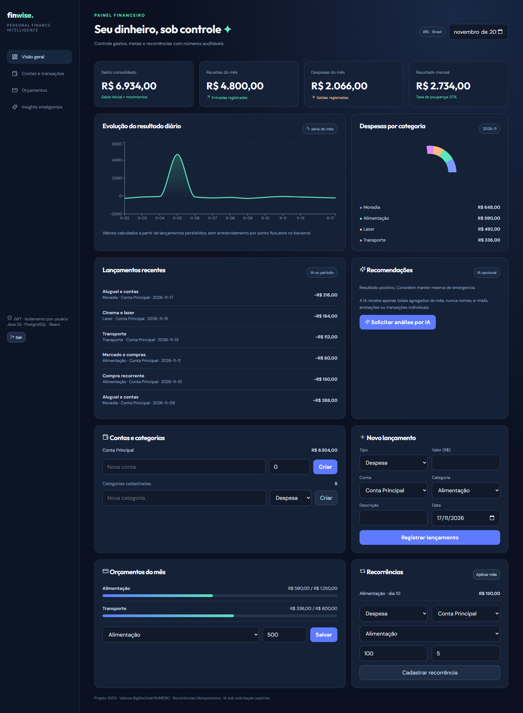

# Plataforma de Finanças Pessoais com IA — Projeto 15/52



MVP full-stack de finanças pessoais com **Java 25, Spring Boot 3.5.7, Spring Security/JWT, PostgreSQL 17, React e Recharts**. IA opcional sob solicitação explícita.

## Funcionalidades

- Registro/login com BCrypt + JWT; dados de contas, categorias, gastos, orçamentos e recorrências isolados por usuário.
- Contas financeiras com saldo inicial e saldo calculado a partir de transações.
- Categorias `INCOME` / `EXPENSE` e lançamentos com valor decimal exato (`BigDecimal` e `NUMERIC(18,2)`).
- Orçamento mensal por categoria, total consumido e sinalização de excesso.
- Recorrências mensais com aplicação explícita e **idempotente** (chave única de regra + mês).
- Dashboard com receitas, despesas, resultado, saldo, taxa de poupança, distribuição por categoria e evolução diária.
- Recomendações locais baseadas em regras; análise opcional por API LLM mediante `OPENAI_API_KEY` **no backend**. Somente totais agregados do mês são enviados quando o usuário solicita.

## Executar

Requisito: Docker Desktop com Docker Compose.

```powershell
docker compose up --build -d
```

- Interface: **http://localhost:5175**
- API: **http://localhost:8085/api/health**

Por padrão **nenhuma chave de IA é necessária**: controle financeiro e recomendações por regras funcionam sem serviço externo. Para ativar análise LLM, forneça `OPENAI_API_KEY` ao serviço `api` via variável de ambiente/gestor de segredos e reinicie o contêiner (não versionar chave).

### Principais endpoints

| Método | Endpoint | Função |
|---|---|---|
| POST | `/api/auth/register` | Criar usuário |
| POST | `/api/auth/login` | Obter JWT |
| GET/POST | `/api/accounts` | Contas |
| GET/POST | `/api/categories` | Categorias |
| GET/POST | `/api/transactions?month=YYYY-MM` | Lançamentos |
| GET/POST | `/api/budgets?month=YYYY-MM` | Orçamentos |
| GET/POST | `/api/recurrences` | Recorrências |
| POST | `/api/recurrences/apply?month=YYYY-MM` | Aplicar regras sem duplicar |
| GET | `/api/dashboard?month=YYYY-MM` | Fluxo de caixa e saldos |
| POST | `/api/advice/ai?month=YYYY-MM` | IA opcional, somente agregados |

Rotas protegidas usam `Authorization: Bearer <token>`.

## Testes e evidência

```powershell
cd backend
mvn -B clean verify
```

O script `PUBLICAR-14-15.ps1` incluído no pacote sobe o Compose, verifica a API, cria dados de demonstração por HTTP, aplica uma recorrência duas vezes para exercitar idempotência e salva **captura da interface React em execução** em `docs/images/funcionamento.png`.

O GitHub Actions realiza build/teste Maven e build React.

## Limites do MVP

**Não usar para guardar dados financeiros reais sem endurecimento adicional.** Credenciais do Compose são locais. Faltam TLS reverso, trilha de auditoria, criptografia operacional, exportação, recuperações, testes de integração multiusuário e controles de retenção. A API de IA pode falhar sem afetar lançamentos ou cálculos. As recomendações não são aconselhamento financeiro individualizado.
